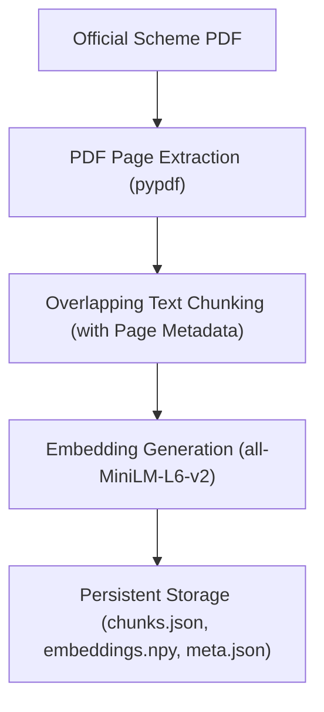
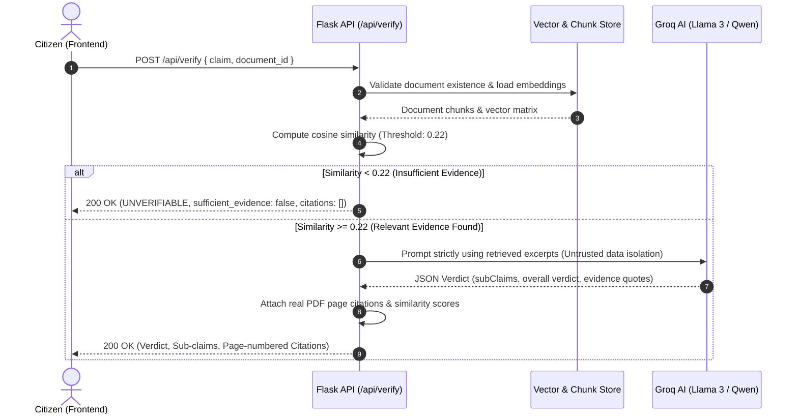

# Sarkari Saathi (सरकारी साथी) 🇮🇳
> **Government Schemes & Civic Policies, Simplified and Source-Grounded for Every Citizen.**

[](https://sarkarisarthi.onrender.com)
[](https://www.python.org/)
[](https://flask.palletsprojects.com/)
[](https://react.dev/)
[](https://www.typescriptlang.org/)
[](https://vitejs.dev/)
[](https://groq.com/)
[](LICENSE)

> 🔗 **Live Web Application:** [https://sarkarisarthi.onrender.com](https://sarkarisarthi.onrender.com)

---

## 📌 Problem Statement

The Government of India and various state administrations administer hundreds of welfare programs, financial subsidies, and social protection schemes. However, millions of eligible citizens face major barriers:

1. **Complex Administrative Jargon:** Official guidelines and policy gazettes are often written in dense, legalistic terminology that is difficult for ordinary citizens to interpret.
2. **Eligibility Ambiguity:** Citizens frequently do not know which schemes apply to their specific socio-economic profile, resulting in unclaimed entitlements.
3. **Complicated Application Workflows:** Bureaucratic procedures and scattered documentation requirements lead to application errors and delays.
4. **Widespread Misinformation:** Viral social media forwards and unverified claims regularly circulate fabricated scheme rules, inflated financial amounts, or fraudulent portals.

---

## 💡 Our Solution

**Sarkari Saathi** is an AI-powered civic companion that bridges the gap between Indian citizens and public policy. By combining high-speed conversational AI (Groq), a source-grounded Retrieval-Augmented Generation (RAG) pipeline, and an evidence-based claim verification engine, Sarkari Saathi provides reliable, transparent, and accessible policy guidance.

Citizens can ask questions in natural language, evaluate their eligibility, fact-check policy rumors against uploaded official documents with exact page citations, and follow structured step-by-step application checklists.

---

## ✨ Key Features

| Feature | Status | Description |
| :--- | :---: | :--- |
| 🤖 **AI Policy Explainer (`/chat`)** | **Fully Functional** | Conversational assistant powered by Groq-hosted LLMs (`llama3-8b-8192` / `qwen3.8-27b`), pre-loaded with comprehensive official guidelines for major national schemes (PM-KISAN, CSSS Scholarship, Ayushman Bharat, PM Mudra, PMAY, PMMVY, SSY). |
| 📄 **Source-Grounded PDF RAG (`/api/documents/*`)** | **Fully Functional** | Upload official scheme PDFs. Preserves 1-indexed page numbers, performs semantic chunking, computes local vector embeddings using `all-MiniLM-L6-v2`, and executes cosine similarity retrieval. |
| 🛡️ **AI Claim Verifier (`/verify`)** | **Fully Functional** | Fact-checks policy statements and viral forwards against official documents. Decomposes claims into atomic sub-claims, assigns granular verdicts (`VERIFIED`, `FALSE`, `MISLEADING`, `UNVERIFIABLE`, `OUTDATED`), and provides exact page-numbered citations. |
| 🎯 **Smart Eligibility Checker (`/eligibility`)** | **Fully Functional** | Rule-based engine that evaluates demographic attributes (age, income, occupation, social category) against statutory scheme criteria to output match scores and qualifying recommendations. |
| 📋 **Interactive Application Guides (`/apply`, `/schemes`)** | **Fully Functional** | Step-by-step application checklists, mandatory document requirements, and verified official government portal links for direct submission. |
| 🌐 **Bilingual & Voice Interface** | **Functional** | Bilingual UI support (English & हिंदी) with browser Web Speech API integration for voice speech-to-text input and natural text-to-speech response playback. |
| 🔐 **User Authentication (`/signin`, `/dashboard`)** | **Functional** | Supabase Auth integration supporting Email/Phone OTP and Google OAuth, backed by stateless JWT sessions and development OTP fallbacks for testing. |

---

## 🛠️ Technology Stack

```
               ┌────────────────────────────────────────────────────────┐
               │                     CLIENT TIER                        │
               │   React 19 • TypeScript • Vite • React Router 7        │
               │   Lucide Icons • Web Speech API • Responsive CSS       │
               └───────────────────────────┬────────────────────────────┘
                                           │ HTTP / JSON API Proxy
                                           ▼
               ┌────────────────────────────────────────────────────────┐
               │                     API GATEWAY                        │
               │   Python Flask • Flask-CORS • Gunicorn WSGI            │
               │   Stateless JWT Authentication • Blueprint Routing     │
               └───────────────┬────────────────────────┬───────────────┘
                               │                        │
            ┌──────────────────▼──────┐      ┌──────────▼─────────────────┐
            │   LLM INFERENCE ENGINE  │      │     PDF RAG PIPELINE       │
            │   Groq Python SDK       │      │   PyPDF (Page Extraction)  │
            │   Llama 3 / Qwen Models │      │   Sentence-Transformers    │
            │   Temperature: 0.1      │      │   all-MiniLM-L6-v2 (CPU)   │
            └─────────────────────────┘      │   NumPy Cosine Similarity  │
                                             │   Local File-Based Vectors │
                                             └────────────────────────────┘
```

- **Frontend:** React 19, TypeScript 7.0, Vite 8.3, React Router 7, Lucide React.
- **Backend:** Python 3.10+, Flask 3.0+, Flask-CORS, Gunicorn 21.0, Supabase Client, PyJWT, python-dotenv.
- **AI & RAG Engine:** Groq API, `pypdf` 5.0+, `sentence-transformers` 3.0+ (`all-MiniLM-L6-v2`), `numpy`.
- **Storage:** Local file-based persistent vector and metadata store (`backend/storage/documents/`).

---

## 🏗️ System Architecture

### 1. Document Ingestion & RAG Pipeline


### 2. Evidence-Based Claim Verification Workflow


---

## 💻 Installation & Local Setup

### Prerequisites
- Node.js (v18.0 or higher) and `npm`
- Python (v3.10 or higher) and `pip`
- Git

### 1. Clone the Repository
```bash
git clone https://github.com/Ananya0907/SarkariSarthi.git
cd SarkariSarthi
```

### 2. Backend Setup
```bash
cd backend

# Create and activate a Python virtual environment
python -m venv venv

# On Windows:
.\venv\Scripts\activate
# On macOS/Linux:
# source venv/bin/activate

# Install dependencies
pip install -r requirements.txt
```

### 3. Backend Environment Configuration
Create a `.env` file inside the `backend/` directory using the provided example:
```bash
cp .env.example .env
```
Populate `.env` with your API credentials (placeholders shown below):
```env
PORT=5000
GROQ_API_KEY=your_groq_api_key_here
GROQ_MODEL=llama3-8b-8192

# Optional Authentication Keys (Supabase)
SUPABASE_URL=https://your-project-id.supabase.co
SUPABASE_ANON_KEY=your_supabase_anon_key_here
JWT_SECRET=your_jwt_secret_key_here
```

### 4. Start the Backend Server
```bash
python app.py
```
The Flask backend starts on `http://127.0.0.1:5000`.

### 5. Frontend Setup
Open a new terminal window:
```bash
cd frontend

# Install dependencies
npm install

# Start Vite development server
npm run dev
```
The application will be accessible at `http://localhost:5173`. The Vite development server automatically proxies requests starting with `/api` to `http://127.0.0.1:5000`.

---

## 📡 API Endpoints

### Core Service & AI Routes

#### `GET /api/health`
Checks backend status and verifies environment configuration.
- **Response:** `200 OK`
```json
{
  "status": "healthy",
  "service": "SarkariSaathi Backend",
  "groq_configured": true
}
```

#### `POST /api/chat`
Conversational AI policy explainer grounded in pre-configured scheme guidelines.
- **Request Body:**
```json
{
  "message": "What is the annual benefit under PM-KISAN?"
}
```
- **Response:** `200 OK` with AI answer and reference scheme information.

#### `POST /api/verify`
Fact-checks a policy claim against an uploaded official PDF document or policy guidelines.
- **Request Body:**
```json
{
  "claim": "PM-KISAN gives 12,000 rupees per year to farmers",
  "document_id": "c24fec73-c115-4845-b340-eca6696f4da3"
}
```
- **Validation Rules:**
  - If `document_id` is empty (`""`): returns `400 Bad Request` with `UNVERIFIABLE`.
  - If `document_id` does not exist: returns `404 Not Found` with `UNVERIFIABLE`.
  - If no relevant evidence exists in the document (similarity `< 0.22`): returns `200 OK` with `overall: "unverifiable"` and `sufficient_evidence: false`.
  - If evidence exists: returns `200 OK` with atomic sub-claim verdicts and real page citations.
- **Response Example:**
```json
{
  "overall": "false",
  "subClaims": [
    {
      "text": "PM-KISAN gives 12,000 rupees per year to farmers",
      "verdict": "FALSE",
      "evidence": "Document states that eligible farmer families receive 6,000 rupees annually in three equal installments of 2,000 rupees.",
      "source": "pm_kisan_guidelines.pdf, Page 1"
    }
  ],
  "citations": [
    {
      "document_id": "c24fec73-c115-4845-b340-eca6696f4da3",
      "filename": "pm_kisan_guidelines.pdf",
      "page": 1,
      "text": "The Pradhan Mantri Kisan Samman Nidhi provides an income support of Rs. 6,000/- per year in three equal 4-monthly installments...",
      "similarity_score": 0.8124
    }
  ],
  "sufficient_evidence": true,
  "filename": "pm_kisan_guidelines.pdf"
}
```

### Document RAG Routes

#### `POST /api/documents/upload`
Uploads and indexes an official PDF document for semantic retrieval.
- **Form Data:** `file`: `document.pdf` (Multipart form-data)
- **Response:** `201 Created` with document metadata (`document_id`, `filename`, `page_count`, `chunk_count`).

#### `POST /api/documents/ask`
Answers questions strictly grounded in an uploaded document.
- **Request Body:**
```json
{
  "document_id": "c24fec73-c115-4845-b340-eca6696f4da3",
  "question": "What is the maximum landholding allowed for eligibility?"
}
```
- **Response:** `200 OK` containing source-grounded answer and page citations.

#### `GET /api/documents`
Lists all processed and indexed official documents available for verification.

#### `GET /api/documents/<doc_id>`
Retrieves metadata for a specific indexed document.

### Authentication Routes

- `POST /api/auth/send-otp` — Initiates Email/SMS OTP generation via Supabase (with dev fallback).
- `POST /api/auth/verify-otp` — Verifies 6-digit code and issues a signed stateless JWT token.
- `POST /api/auth/google` — Exchanges a Supabase Google OAuth session token for an application JWT.
- `POST /api/auth/refresh` — Refreshes an active session token.
- `POST /api/auth/logout` — Concludes user session.

---

## 👥 Team Contributions

Sarkari Saathi was collaboratively designed and developed for the GenAI Hackathon by:

### **Neha — AI & Backend Development**
- Built the Flask REST API architecture and route handlers.
- Integrated the Groq Python SDK for ultra-low latency LLM inference using Llama 3 and Qwen.
- Developed the initial frontend foundation and responsive layouts.
- Conducted technical system debugging and API communication integration.

### **Ananya — RAG & AI Verification Development**
- Designed and implemented the modular PDF Retrieval-Augmented Generation (RAG) pipeline (`pypdf`, chunking, embeddings, and cosine similarity).
- Developed the AI Claim Verifier engine with evidence extraction, page-number preservation, and hallucination guardrails.
- Built end-to-end frontend–backend integration for document selection and interactive citation cards.
- Engineered comprehensive test suites for RAG and Claim Verification.

### **Dhruvika — Frontend & Feature Development**
- Designed and built the user authentication interface supporting OTP and Google OAuth workflows.
- Implemented user experience enhancements and application guidance components.
- Developed responsive navigation, interactive UI drawer states, and visual design polish across application modules.

---

## 🧪 Testing & Quality Assurance

The project includes automated regression test suites covering RAG ingestion, cosine similarity thresholds, claim decomposition, and frontend production bundling.

```bash
# Run existing RAG pipeline tests (10 test cases)
python backend/tests/test_rag_pipeline.py

# Run legacy claim verifier tests (6 test cases)
python backend/tests/test_claim_verifier.py

# Run RAG-grounded claim verifier tests (7 test cases)
python backend/tests/test_rag_claim_verifier.py

# Run frontend type-check and production build
cd frontend && npm run build
```

### Test Suite Summary

| Test Suite | Scenarios Evaluated | Results |
| :--- | :--- | :---: |
| `test_rag_pipeline.py` | Valid PDF upload, page extraction, overlapping chunking, local vector embedding, semantic search, evidence thresholding, corrupted PDF rejection, missing API key handling. | **10 / 10 PASS** |
| `test_claim_verifier.py` | Claim decomposition, verdict mapping, case normalization, service failure fallbacks, malformed JSON handling. | **6 / 6 PASS** |
| `test_rag_claim_verifier.py` | Supported claim verification, contradicted claim refutation, unsupported claim threshold guard, missing `document_id` validation, invalid `document_id` rejection, Groq outage fallback, isolated multi-document evaluation. | **7 / 7 PASS** |
| `frontend build` | TypeScript compilation (`tsc -b`) and Vite production bundle generation. | **PASS (0 errors)** |

> **Note on Live Inference:** Automated test suites employ isolated, deterministic mock LLM completions to rigorously validate verification thresholds without incurring network latency or API rate limits. Live end-to-end inference against Groq is active when a valid `GROQ_API_KEY` is provided in `backend/.env`.

---

## ⚠️ Limitations & Future Roadmap

1. **OCR Support for Scanned Documents:** The current text extraction module utilizes `pypdf`, which requires digital text streams. Government gazettes that exist purely as scanned photocopies require integrating an OCR engine (such as Tesseract or AWS Textract).
2. **Multi-Column & Complex Table Parsing:** Linear text extraction can introduce whitespace noise when chunking intricate multi-column tabular data in gazettes. Implementing layout-aware table parsers (e.g., `pdfplumber` or LayoutLM) is planned.
3. **Real-Time Portal Telemetry:** Verification is strictly grounded in official guidelines and uploaded gazettes. Live database pings to PFMS (Public Financial Management System) or state disbursement portals for individual status tracking are planned for future phases with official API access.
4. **Expanded Regional Language Coverage:** Extend full translation and speech synthesis from English and Hindi to all 22 official Eighth Schedule languages of India.

---

## 🚀 Deployment

The platform is live and deployed on Render:
- 🌐 **Live Website:** [https://sarkarisarthi.onrender.com](https://sarkarisarthi.onrender.com)

### Production Architecture
- **Frontend:** Built via Vite (`npm run build`) and served as an optimized Single Page Application (SPA) with rewrite rules (`frontend/public/_redirects`).
- **Backend:** Python Flask API served via Gunicorn WSGI:
  ```bash
  gunicorn -w 4 -b 0.0.0.0:5000 app:app
  ```

---

## 📜 Disclaimer

*Sarkari Saathi is an independent civic technology platform developed for educational and hackathon purposes. It is not affiliated with or endorsed by any government ministry or department. Citizens should always verify critical decisions and submit applications directly through official government portals (e.g., `india.gov.in`, `scholarships.gov.in`, `pmkisan.gov.in`).*